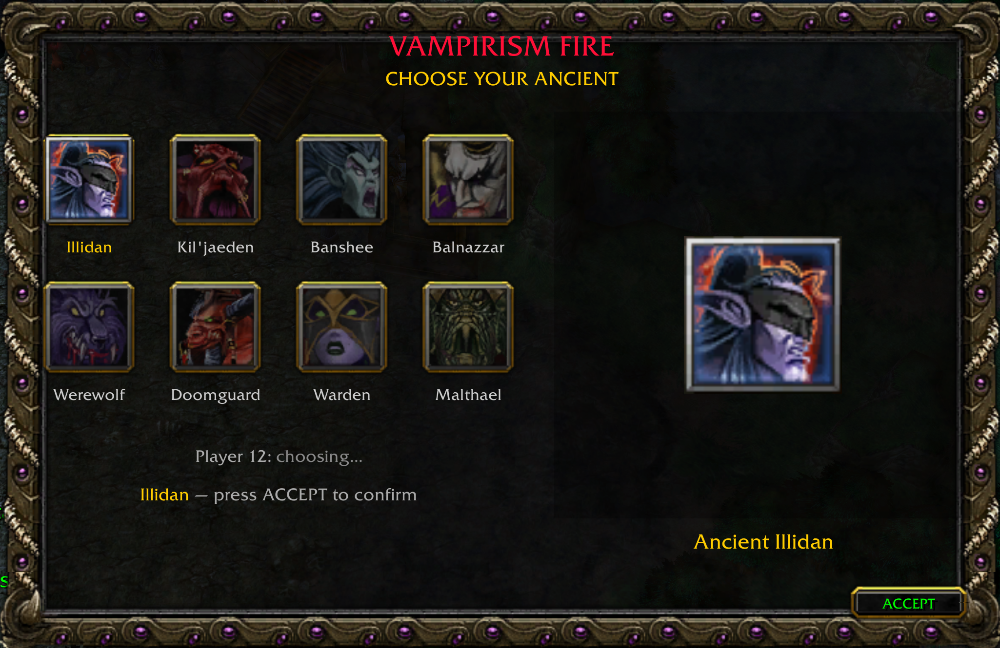
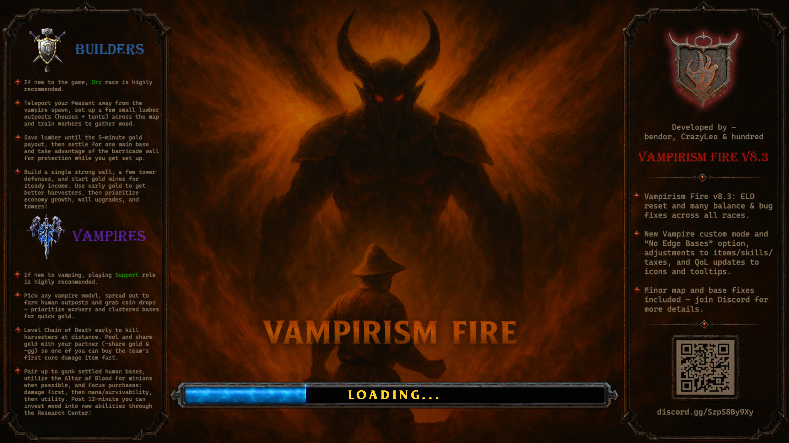
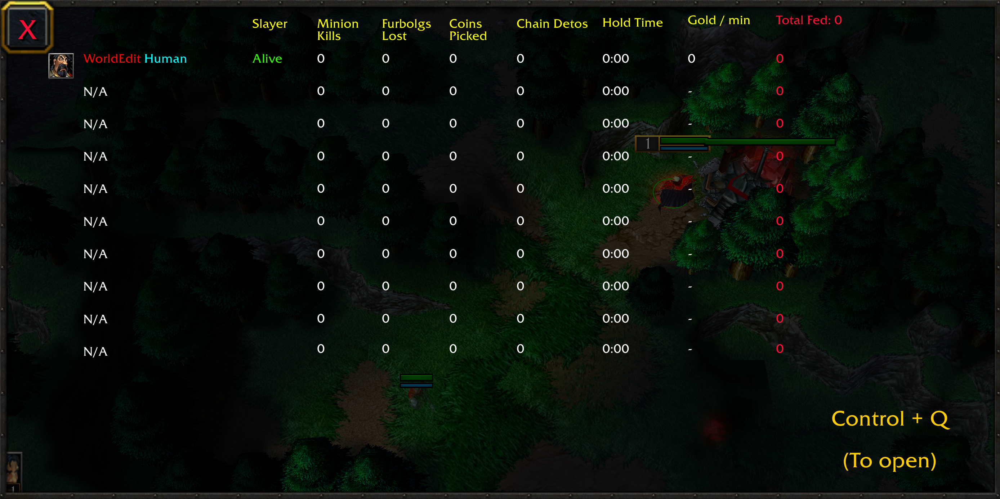
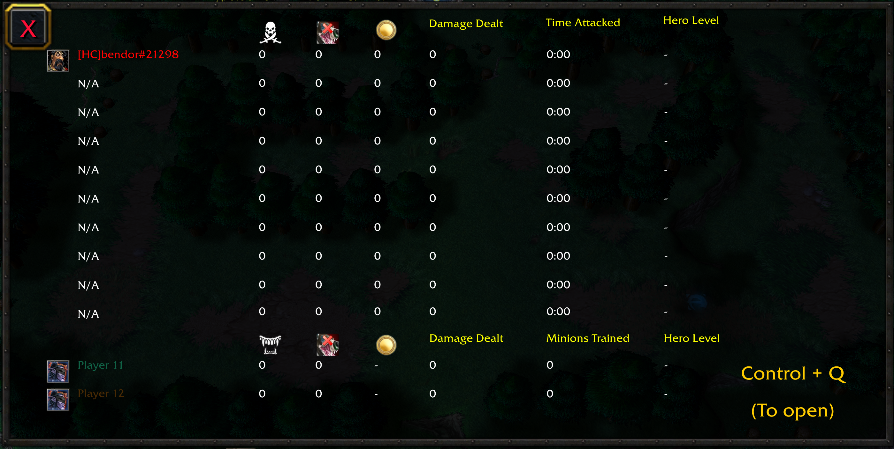
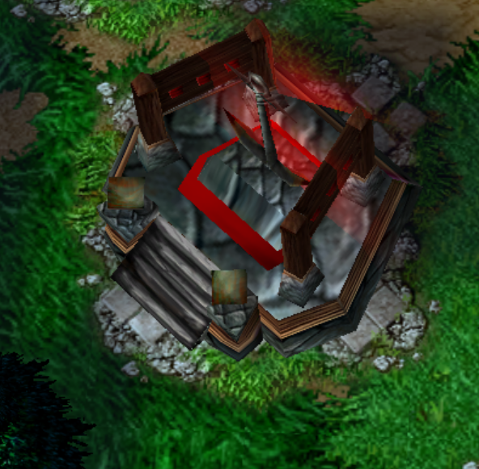
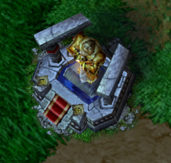
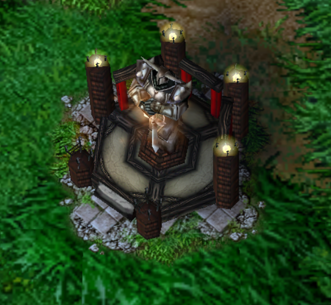
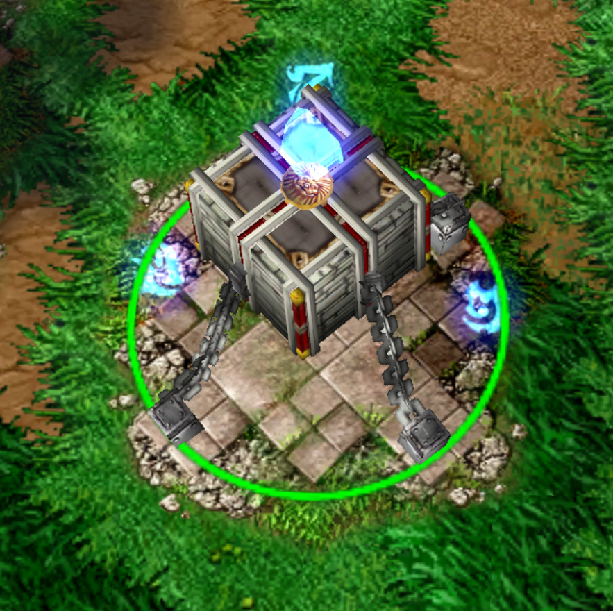
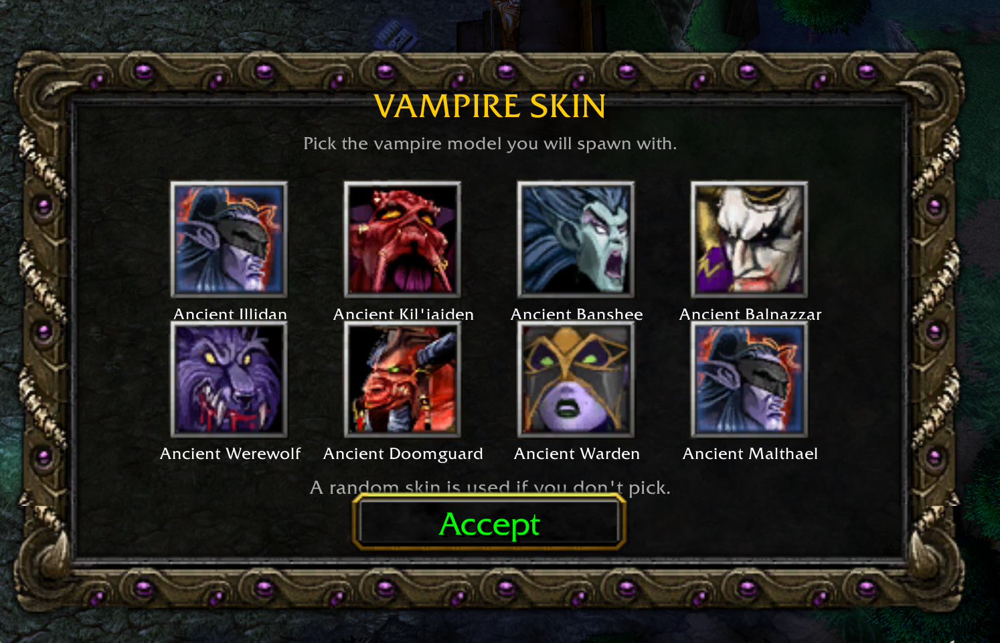

# Vampirism Fire 8.4

---

## Main

- Updated clan tags.
- Definitive Edition graphics are temporarily disabled for this map.

- Updated clan tags.
- Finishing a **wall** now displays the message **"Wall finished!"** (not shown for the cheap Carnelian and Topaz walls).
- The leak rate can now be increased by 1 per click instead of 5.
- Improved the [loading-screen] fading effect.
- Improved map loading during initialization.
- The loading fade-out no longer displays the information panels while the map finishes loading.
- Removed the author credit names from the map description.
- **Ctrl+Q** stats panel rebuilt around builders, with new columns for Furbolgs detonated by Chain of Death and minion kills.
- [The-Casino] is now available after minute **10**.
- Fixed an issue where buying items from the **builder's neutral shop** would display message **"Only vampires can hire these units."**
- Trees are now harvestable in **No Edge Base** mode.
- The [Gold-mine] income setting was removed from Mode Selection.
- Builders wearing a cosmetic skin now play an animation while repairing (they used to stand still).
- Fixed the **Temple of Prayer** pact strip (top-right corner) appearing before minute 12 or when hovering over that corner.
- New **loading screen**, game-start splash and **lobby picture** for 8.4. The loading screen lists the 8.4 updates and the most useful chat commands.
- The host now picks the **game mode before** everyone chooses a race, so races are picked knowing the mode. The race menu shows the chosen mode.
- [Blood-Tower] fixed hits sometimes making a vampire's armor jump up or down by about **1,000,000** (broken by Warcraft III patch 3.0; same fix as 8.3.9).
- Walls and towers keep their normal size while upgrading (Garnet -> Ruby wall and the Sacrificial Tower used to grow huge until the upgrade finished).
- `-show` command UI design reworked.
    
    Before:

    

    After:

    

- Mode selection UI will now show the mode buttons for all players.

    Before:
    
    

    After:
    
    

- New lobby screen:

    

- New loading screen:

    Before:

    

    After:

    

- New Ctrl+Q UI

    - Before:

    

    - After:

    

## Main balance

- Builders now gain **4 gold** at minute 4 instead of minute 5.
- [Workers] 
    - The hatchet timer was reduced from 3:30 to 2:30.
    - The upgrade now arrives for every builder at the same time. It was previously staggered per
      player, with compensating lumber; that compensation was removed along with the stagger.
    - Wood gain increased by **50%**.

- [Command-Center] gold cost reduced from **400 to 375**.

- [Slayer] training time reduced from **60 to 15** seconds.

- [Building-Protection] (Slayer) gains a **level 3** at minute 42, reducing its cooldown from **300 to 150** seconds.

- [Goblin-Tower-Builder]
    - Gold cost reduced from **150 to 100**.

- [Vampire-Spire] base damage increased from **10,000 to 11,500**.

- [Anti-Tower-Share]
    - A vampire standing inside a claimed base can now be attacked only by that base's owner. The protection drops 1–2 seconds after the vampire leaves the base.
    - Architect **Topaz**, **Ruby**, **Red Beryl**, and Orc **Topaz** walls are now recognized as walls, so tower-share lock, Hellfire, Corrupting Breath, Frail Bricks, and other wall effects work on them.

## Solo vamp mode

- **pillage** ability removed.
- At minute 15, killing a Furbolg with Chain of Death reduces the vampire chain's cooldown by 50%.

## ELO system

- Ranked games now use the match result and both teams' average ELO to calculate rating changes. Winning gains ELO and losing costs ELO; the previous system could award ELO to a losing player.
- Human ELO changes also reflect how long each builder survived. Early deaths cost more, while builders who hold out for most of a lost game lose less. Builders who leave are rated for the time they played, and bitten builders are rated as human losses.
- Vampire partners receive the same ELO change. Winning faster gives both vampires a larger gain.
- Separate ELO ladders were added for standard 10v2, Solo Vampire, and 1v1 games, with distinct Human and Vampire ratings in each.
- The host can choose Ranked or Unranked when selecting a mode. A game only affects ELO if its mode's required lobby size is met at lock-in: 10 builders and 2 vampires for the shared ladder, 5 builders and 1 vampire for Solo Vampire, or 1 builder and 1 vampire for 1v1. Unranked games still count toward games played and wins.

## Human

- [Sacrificial-Tower]
    - Added to Quell Reach.
    - Level 1 build time decreased from **30 to 10** seconds.
    - Level 2 build time decreased from **30 to 15** seconds.

- New building models: **Temple of Prayers**, **Human's Vault**, **Slayer's Tavern**, and **Human Surplus**.
- [Human's-Vault] name fixed (was W by mistake).
- [Fang-Blade] gold cost reduced from **40 to 34**.
- [Gold-Buy] ability is now available at minute **4** instead of minute 5.
- [Base-Of-Operations] gold cost reduced from **1,000 to 600**.
- [Orange-Calcite-Outpost] now requires **Citadel of Faith**.
- [Eclipse-Tower] and [Super-Eclipse-Tower] can now be **repaired**.
- [Improved-Gem-Quality] no longer grants the additional **HP**.
- [Healing-Tower] armor reduced from **75 to 15**.
- [Healing-Tower] can now be toggled between automatic healing and manual casting with right-click.
- [Divine-Intervention] now counts a solo vampire as two vampires.

- New models:
    - Slayer's Tavern:
    
    Before:

    

    After:

    

    - Temple of Prayers :

    Before:

    

    After:

    

    - Human Surplus:

    Before:

    

    After:

    

    - Human's Vault:

    Before:

    

    After:

    

## Architect

- [Gold-Buy] ability is now available at minute **5** instead of minute 6.
- [Base-Of-Operations] gold cost reduced from **1,000 to 800**.
- [Orange-Aqua-Outpost] now requires **Citadel of Faith**.
- [Improved-Gem-Quality] no longer grants the additional **HP**.
- [Shrine-Tower] splash damage fixed.
- [Robotic-Builder] can now build **Architect Surplus**.
- [Advanced-Disaster-Tower] HP decreased from **3,500 to 3,000**.
- [Ultimate-Disaster-Tower] HP decreased from **6,500 to 5,000**.

## Orc

- [Gold-Buy] ability is now available at minute **5** instead of minute 6.
- [Super-Wall-Tower] now has an orange color.
- [Super-Tower-Builder] HP reduced from **435 to 400**.
- [Fang-Harvester] HP increased from **6,500 to 10,000**.
- [Arcane-Tower] HP decreased from **3,000 to 2,000**.
- [Healing-Tower] and [Super-Healing-Tower] heal buttons now work like **Repair**: **right-click** toggles auto-heal on or off for that tower (a golden swirl indicates that it is on), while left-click still heals a target of your choice. Towers start with auto-heal enabled.

## Vampires

- [Vampires-Selection] UI improved.

    Before:
    
    

    After:

    

- [Silent-Whisper] fixed an issue where the **poison** ability would last longer than the **silence** itself.

- [Silent-Whisper] no longer locks the furbolgs' **Detonate**, only their blinks.

- [Health-Beam] mana costs increased:
    - Level 1: **100 to 200**
    - Level 2: **150 to 325**
    - Level 3: **225 to 450**
    - Level 4: **375 to 700**
    - Level 5: **775 to 850**
    - Level 6: **950 to 1,200**
    - Level 10: **3,400 to 3,800**

- [Blood-Particle] Level 2 was removed.

- [Vampiric-Awakening] now clears **every builder building outside the base borders**: any race, any building type, finished or still under construction, including buildings blocking the paths next to base entrances. The gold payout is unchanged.

- [Chain-Of-Death] bounces again at levels 5-15 (broken by Warcraft III patch 3.0.1).

- [Urn-Of-Farsight] duration increased from **10 to 15** seconds; mana cost is **50**.

- [Dracula's-Reaver-Of-Fire] now has two levels:
    - Level 1 (shop, unchanged price): **+200** damage and the **stun** (18%, 1 second, drains 100 mana and purges). The burn moved to level 2.
    - Level 2: combine the Reaver with **2 Large Claws of Attack**. **+350** damage, the stun **and** the burn (18%, 150 bonus damage). New icon.

- [Dark-Spear] active damage bonus increased from **+200 to +450**.

- [Dracula's-Equipment] is now available at minute **14**.

- [Hell-Hound] cooldown reduced from **30 to 15** seconds.

- [Scythe-Of-Necromancy] Reapers reworked so they no longer stand idle:
    - Only attacks buildings of players who are **dead or left**, within **2500** range.
    - Targets **Blood Boxes** first, then **gold mines**, then everything else, nearest first.
    - **Blinks** to a target more than **900** away.
    - Expires early when nothing is left to destroy.
    - You can still order it manually; it goes back to auto-targeting when the order ends.
    - A use only counts toward the late-game limit after it has actually killed a building.

- Tax system threshold decreased from **25 to 24** minutes.

- **Vampires** now change direction without stopping. Warcraft units halt and rotate on the spot
  before moving when ordered more than 60 degrees off their facing, which made every reversal
  pay a stall; vampires now set off immediately on any heading and turn as they travel.

- **Vampires** spawn timer reduced from **55 to 35** seconds.

- Mana Resistance Shield stock timer reduced from 7:05 to 6:00.

- [Recipe-Dracula's-Equipment] stock timer reduced from **15 to 14** minutes.

- [Demonic-Remains] and [Sword-Of-Dracula] stock timers changed from
  23 -> 24 -> 25 to 22 -> 23 -> 24 minutes.

- [Infernal] stock start delay reduced from **420 to 300** seconds.

- [Burst-Gem]
    - Stock start delay changed from **0 to 12** minutes.
    - A second Burst Gem is allowed at minute 24.
    - Gold cost reduced from **240 to 175**.

- [Ricochet-Gem]
    - Stock start delay changed from 15 to 24 minutes.
    - A second Ricochet Gem is allowed at minute 36.

- [Gauntlets-Of-The-Underworld]
    - Gold cost reduced from **2,000 to 1,500**.
    - Now available at minute **31**.

- [Dracula's-Cloak]
    - Requires the recipe **Recipe - Dracula's Cloak** again; its gold cost increased from **175 to 500**.
    - The combined item **Dracula's Cloak** damage was reduced from **10,500 to 8,500**.
    - Scaling damage is now **+750** per minute from minute 37 through minute 60, capped at **+18,000**.

- [Gauntlet-Of-Renfield]
    - Stock timer increased from **54 to 55** minutes.
    - Attack speed gain increased from **30% to 50%**.

- [Sphere-Of-Doom]
    - Gold cost reduced from **700 to 650**.
    - Now available at minute **20**.

- [Income-Changes]:
    - The minute-24 income timer moved to minute 23.
    - The minute-36 income timer moved to minute 35.

- [Assassin] | [Meat-Carrier] | [Grave-Robber] | [Fel-Beast]
    - Stock start time reduced from **12 to 10** minutes.

- [Frozen-Infernal] | [Corrupted-Infernal]
    - Now available at minute **23** instead of minute 24.

- [Infernal-Meteor]
    - Now available at minute **14** instead of minute 15.

- [Sword-Of-Dracula]
    - New icon:

    Before:

    

    After:

    

- New item: [Stanimir-Remains] (idea from v7) **(currently disabled and not sold in 8.4)**
    - Same unlock timers as [Sword-Of-Dracula] or [Demonic-Remains].
    - Gold cost is **1,050g** at minute 22, **950g** at minute 23, and **850g** at minute 24.
    - Grants **+4,000 damage** and no other stats.
    - Two **Stanimir Remains** can be combined like **Vladimir Remains**.

- New item: [Silent-Sphere-Of-Doom]
    - Gold cost: **850g**.
    - Does not warn when purchased.
    - Available at minute **20**, like the [Sphere-Of-Doom].
    - Its shop title and tooltip now say it is silent.

- New item: [Gauntlet-Of-Damnation] (new icon)
    - Combines with **Gauntlets of Hellfire**.
    - Gold cost: **2,000**.
    - Passive ability: stacks **+100 damage** per hit when attacking a wall. The effect is lost after 4 seconds without attacking a wall.
    - Available at minute 42.

- New item: [Nosferatu's-Mantle] (new icon)
    - Sold at the **Demonic Gate**; combines with **Sword of Dracula**, which is consumed.
    - **+1250 STR**
    - **+1250 AGI**
    - **+1250 INT**
    - Passive ability: stacks **+25 damage** per hit when attacking a wall. The effect is lost after 4 seconds without attacking a wall.
    - Unlike [Gauntlets-Of-Hellfire], the stack does not double when a second Vampire is nearby and does not gain the Pro mode bonus.
    - Gold cost: **2,000**, or **2,850** once combined.
    - Available at minute **34**.

- Added back item: [Nocturnes-Edge]
    - **+250 STR**
    - **+250 AGI**
    - **+1000 INT**
    - **7,500 base damage**.
    - Gold cost: **2,000**.
    - Available at minute **34**.
    - Can be combined with **Stanimir Remains** to make an upgraded version with **11500 base damage** (inactive while Stanimir Remains is disabled).
    - New icon:

    Before:

    

    After:
    
    

## Other fixes
- Fixed tooltips for Punisher, Dracula's Equipment, Gauntlets of Renfield, Silent Whisper, and Dracula's Cloak (which advertised +10,500 damage instead of the +8,500 it grants).
- [Vladimir's-Remains] and [Stanimir's-Combined-Remains] now need only **one** free inventory slot to separate. They previously required two, which meant three slots including the slot occupied by the combined item.
- Custom VIP blinks now apply: players with a personal blink (for example, Bendor or Valentine) no longer silently receive the default blink.
- Pinned World Editor ability fields so saves no longer silently overwrite configured values; this also restores the Chain of Death bounce radius.
